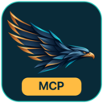

# Turul MCP artwork

Square PNG icons: [512px](icon-512.png), [256px](icon-256.png), [128px](icon-128.png).
The [SVG layout](icon.svg) embeds the raster bird; it is not a fully vector logo.

Use the horizontal light/dark lockups in README headers and the square icon in project cards. The shared bird-only favicons are available in the [master brand repository](https://github.com/aussierobots/turul-brand). GitHub repositories share the organisation avatar; these icons do not set a per-repository avatar.

Artwork rights reserved: [notice](ARTWORK-NOTICE.md). Software licences are unchanged.
